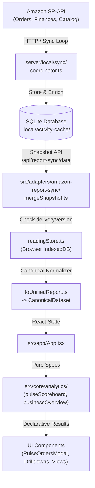

# PROJECT_MAP.md — Fast Navigation & Architecture Index

> **Purpose**: A quick, high-density index of the codebase for agents and developers to navigate, debug, and implement features without re-reading hundreds of pages of documentation.

---

## 1. Directory Structure at a Glance

```text
azulia-seller-flow/
├── src/
│   ├── app/                    # Application shell, layout, and global state orchestration
│   │   ├── App.tsx             # Root component; loads reports, orchestrates filters and views
│   │   ├── AppShell.tsx        # Top navigation bar, tabs, and layout wrapper
│   │   └── useAutomaticReport.ts # Hook subscribing to live/cached report revisions
│   ├── components/             # Reusable UI views, scoreboards, and drilldowns
│   │   ├── PulseScoreboard.tsx # Today/Yesterday/Live Pulse metric cards
│   │   ├── PulseOrdersModal.tsx# "Today (so far) Orders" pop-up modal
│   │   ├── ProductPage.tsx     # Single product deep-dive profile
│   │   ├── MetricSkuDrilldown.tsx # Leading SKU tables, top movers, concentration
│   │   ├── FocusPriorities.tsx # Action board & priority focus recommendations
│   │   ├── InlineOrderDetail.tsx # Per-order drilldown panel
│   │   ├── ProductThumbnail.tsx# Universal product image component
│   │   └── ReportSearch.tsx    # Universal omni-search for SKUs, orders, and products
│   ├── features/               # Specialized workflow screens
│   │   ├── costs/CostMaster.tsx # Product landed costs history & editor
│   │   └── returns/ReturnAnalysis.tsx # Returns audit, rate tracking, and SKU impact
│   ├── core/                   # ⚠️ PURE TYPESCRIPT ONLY (No React, DOM, Dexie, or Marketplace specifics)
│   │   ├── data/types.ts       # Canonical financial types (CanonicalFinancialEvent, CanonicalOrder)
│   │   ├── analytics/          # Business analytics calculation engines
│   │   │   ├── pulseScoreboard.ts # Real-time sales, order classification, AOV estimations
│   │   │   ├── businessOverview.ts # High-level summary metrics (gross sales, profit, returns)
│   │   │   ├── orderProfit.ts  # Net profit calculation per order/SKU
│   │   │   └── sellerProductOverview.ts # Aggregated SKU profitability & economics
│   │   ├── costs/              # Cost of Goods Sold (COGS) calculation policies
│   │   └── search/productTitles.ts # SKU/ASIN title and thumbnail image resolvers
│   └── adapters/               # Marketplace-specific parsing and transport
│       ├── amazon-report-sync/ # Local SQLite backend transport & snapshot normalization
│       │   ├── protocol.ts     # SyncStatus, SourceOrderSummary, SyncSnapshot schemas
│       │   ├── readingStore.ts # IndexedDB cache storage (deliveryVersion: 9)
│       │   └── toUnifiedReport.ts # Converts raw SP-API rows into CanonicalDataset
│       ├── amazon-hosted/      # Netlify on-demand client relay (browser IndexedDB cache)
│       └── amazon/             # Flat report CSV normalizers (Amazon Unified Transaction)
├── server/
│   ├── local/                  # Local standalone backend (Port 8788)
│   │   ├── start.ts            # Local daemon launcher
│   │   ├── server.ts           # HTTP loopback server (/api/report-sync/*)
│   │   └── sync/               # Background SP-API synchronization engine
│   │       ├── coordinator.ts  # Scheduling loop for orders, catalog, and finances
│   │       ├── store.ts        # SQLite storage engine (.local/activity-cache/)
│   │       ├── orders.ts       # SP-API orders & line-items reader
│   │       └── catalog.ts      # SP-API catalog product title & image reader
│   └── relay/                  # Netlify serverless function relay handler
└── netlify/functions/amazon.ts # Serverless entry point for hosted mode
```

---

## 2. End-to-End Data Pipeline



---

## 3. Two Operating Modes

| Feature | Local Mode (`npm run local`) | Hosted Mode (Netlify) |
| :--- | :--- | :--- |
| **URL** | `http://127.0.0.1:8788` | `https://*.netlify.app` |
| **Credentials** | Stored securely in `.local/amazon-credentials.json` | Entered in browser session (in-memory only) |
| **Sync Engine** | Background Node daemon syncing to local SQLite | Netlify Function relay (`/.netlify/functions/amazon`) |
| **Storage** | SQLite (`.local/activity-cache/`) + IndexedDB | Browser IndexedDB |

---

## 4. Key Engineering Invariants (From AGENTS.md)

1. **`core/` Independence**: Pure TypeScript only. Never import React, DOM, Dexie, DuckDB, or marketplace-specific code into `src/core/`.
2. **UI Separation**: UI components must never calculate business metrics or P&L. They pass specifications to `core/` engines and render results.
3. **Financial Conservation**: Source monetary total must equal normalized monetary total. Never fabricate order totals into product sales.
4. **Cache Invalidation**: When modifying normalized schemas or delivery types, bump `deliveryVersion` in [`readingStore.ts`](file:///mnt/new-volume/Projects/azulia-seller-flow/src/adapters/amazon-report-sync/readingStore.ts#L5) so browser IndexedDB refreshes instantly.

---

## 5. Instant Diagnostic Commands

```bash
# Check if local backend is running and what revision it has
curl -s http://127.0.0.1:8788/api/report-sync/status | jq .

# Verify live order enrichment (titles, thumbnails, SKUs)
curl -s http://127.0.0.1:8788/api/report-sync/data | jq '.orders[-3:]'

# Run a single test file rapidly (<1s instead of 8s full suite)
npx vitest run src/core/analytics/pulseScoreboard.test.ts

# Fast typecheck only (skipping server/relay if working on frontend)
npx tsc --noEmit
```
